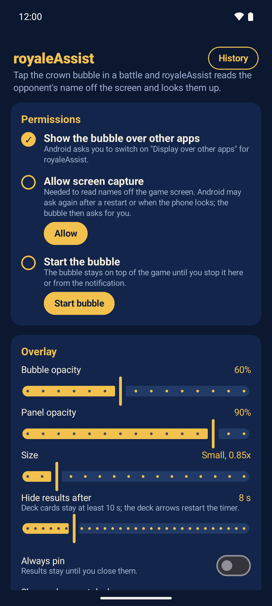
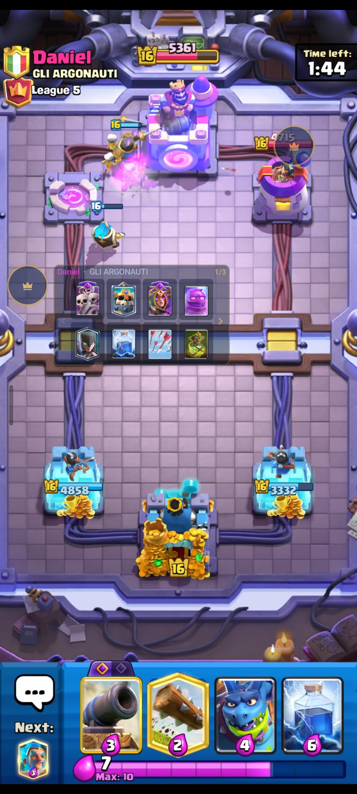
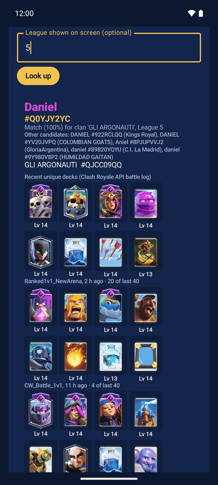
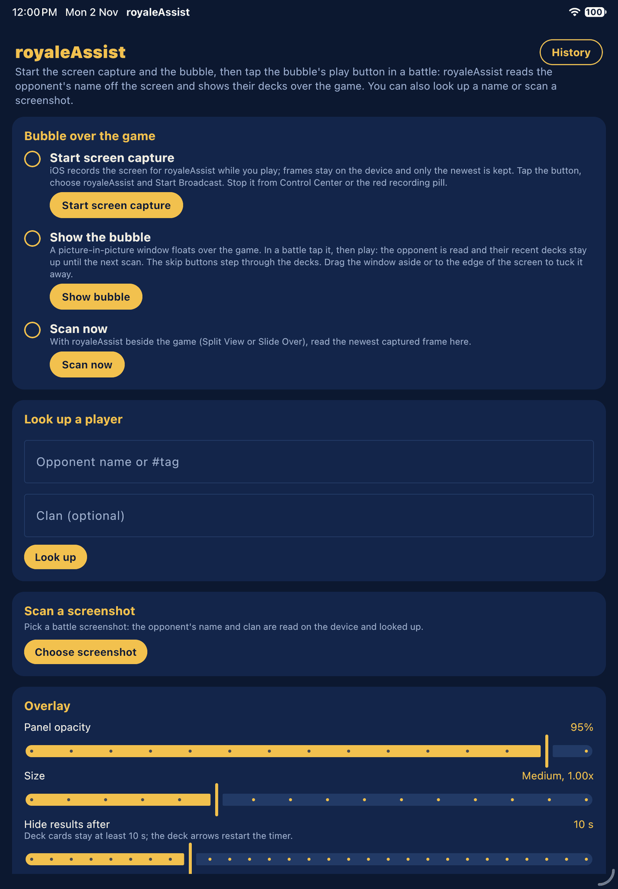
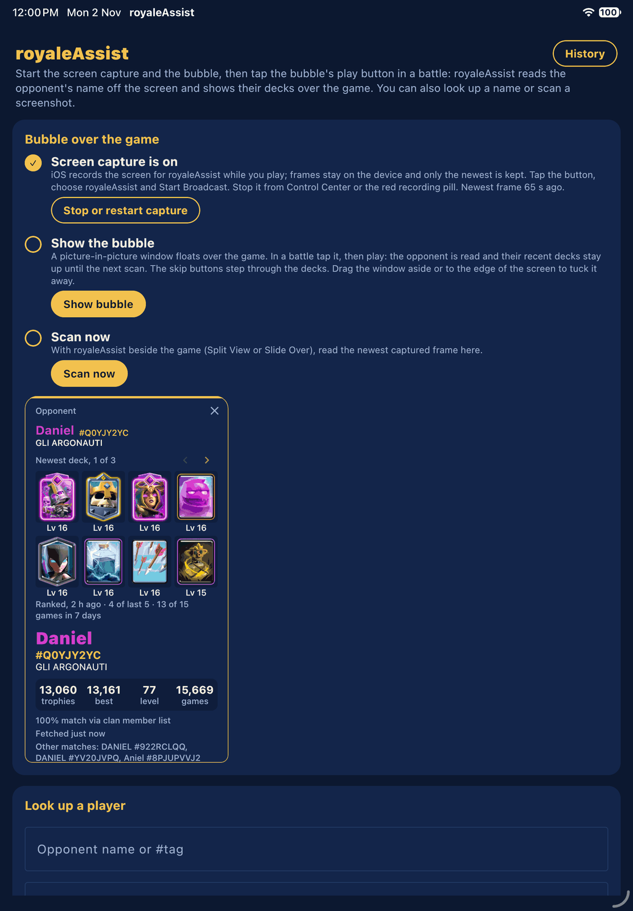
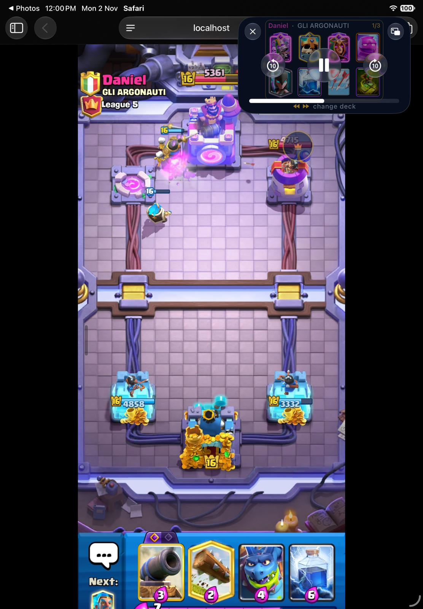

# royaleAssist

## What it does

royaleAssist shows you your Clash Royale opponent's recent decks while the battle is running. It reads the opponent's name and clan off the battle screen on the device, looks the player up, and shows their last few unique decks over the game. It runs on Android (floating bubble) and on iPhone/iPad (Picture in Picture window).

## Screenshots

| | |
|---|---|
|  |  |
| Android: Setup | Android: the bubble's deck card over a battle |
|  |  |
| Android: a player looked up by name | iPad: Setup, "Bubble over the game" |
|  |  |
| iPad: Scan now result | iPad: the Picture in Picture deck card over a battle |

## How it works

1. **Bubble.** On Android a crown bubble floats over the game. On iOS the bubble is a Picture in Picture window, and its play button stands in for the tap.
2. **Screen capture.** Android uses screen capture (MediaProjection). On iOS a ReplayKit broadcast extension keeps only the newest frame, inside the app's shared container. Frames never leave the device.
3. **OCR.** Only the scan region is read: the opponent's name, clan and league. If no name turns up there, the whole screen can be read too. Android uses ML Kit with a Tesseract fallback; iOS uses Apple Vision.
4. **Lookup.** The name is searched on royaleapi.com. The clan and league pick the right player among people with the same name. With an official Clash Royale API token (optional, pasted in Setup) the card also shows wins, losses and the deck from the official API.
5. **Deck card.** The card shows the opponent's recent unique decks, newest first. Step through them with the arrows on Android, or with the skip buttons in the iOS window.

On Android the result hides by itself after the "Hide results after" time, but a deck card always stays up for at least 10 s, and the deck arrows restart that timer. Tap the card to pin it. "Player not found" hides after a few seconds. On iOS the card stays in the Picture in Picture window until the next scan.

RoyaleAPI is behind a Cloudflare browser check. When that check expires, the bubble turns red with a "!" badge (on Android the notification says so too). Open royaleAssist and tap **Verify RoyaleAPI** again.

## Install

**Android** (8.0 or newer): download `royaleAssist-<version>.apk` from [GitHub Releases](https://github.com/Macle57/royaleAssist/releases) and open it. Android asks you to allow "Install unknown apps" for your browser or file manager the first time.

**iOS / iPadOS** (18 or newer): there is no App Store build. Pick one of these:

- Sideload the unsigned `royaleAssist-<version>-unsigned.ipa` from [Releases](https://github.com/Macle57/royaleAssist/releases) with your own Apple ID, using a tool such as Sideloadly or AltStore.
- Build from source (below) and run it from Xcode on your device.

With a free Apple ID the profile expires after 7 days. After that, sideload or build again.

## First-time setup

1. **Verify RoyaleAPI.** In Setup, tap **Verify RoyaleAPI** and tick the Cloudflare checkbox if one appears. The status line should then say "RoyaleAPI: verified".
2. **Screen capture.**
   - Android: allow "Display over other apps", then tap **Allow** under "Allow screen capture" and choose **Start**.
   - iOS: tap **Start screen capture**, choose royaleAssist in the broadcast picker, then tap **Start Broadcast**. Stop it from Control Center or the red recording pill.
3. **Show the bubble.** Tap **Start bubble** on Android or **Show bubble** on iOS, then switch to the game. In a battle, tap the bubble (Android) or press play in the window (iOS).
4. **Scan region (optional, Android).** Open a battle, long-press the bubble (or tap **Set scan region**), then drag the box over the opponent's name and clan. A smaller region is read faster.

## Build from source

You need JDK 21 and the Android SDK (`local.properties` with `sdk.dir`).

```sh
./gradlew :androidApp:assembleDebug        # androidApp/build/outputs/apk/debug/
./gradlew :shared:testAndroidHostTest      # shared JVM tests
```

Release builds are signed with the key described in `keystore.properties` in the repo root (gitignored; keys `storeFile`, `storePassword`, `keyAlias`, `keyPassword`). Without that file, `assembleRelease` falls back to the debug key.

The iOS app builds on a Mac with Xcode 26 or newer:

```sh
brew install xcodegen
cp iosApp/Local.xcconfig.example iosApp/Local.xcconfig   # set DEVELOPMENT_TEAM to your Apple team ID
cd iosApp && xcodegen
open royaleAssist.xcodeproj                               # build and run the royaleAssist scheme
```

Xcode builds the Kotlin framework through Gradle with JDK 21. Set `ROYALEASSIST_JAVA_HOME` if your JDK 21 is not at the Homebrew `openjdk@21` path.

iOS tests: `./gradlew :shared:iosSimulatorArm64Test`.

## Project layout

- `shared/`: Kotlin Multiplatform code: OCR name picking, lookup, cache, settings and the Compose Multiplatform UI (`commonMain`), with Android and iOS parts in `androidMain` / `iosMain`.
- `androidApp/`: the Android app: overlay service and bubble, screen capture, ML Kit / Tesseract OCR, Cloudflare verify activity.
- `iosApp/`: the XcodeGen project: the SwiftUI shell and Picture in Picture bubble (`royaleAssist/`) and the ReplayKit broadcast extension (`royaleAssistBroadcast/`).
- `samples/`: battle screenshots and crops used by tests and the debug harness.
- `tools/`: scripts that run the OCR over the sample corpus on a device and report the results.
- `assets/`: the app icon.
- `docs/screenshots/`: the images above.

## Limitations

- RoyaleAPI's Cloudflare check expires from time to time. Lookups then fail until you verify again; the red "!" bubble tells you when.
- Devanagari names are not read on iOS; Android reads them with ML Kit.
- The iOS Picture in Picture window can cover the opponent's name. Drag it away from the top-left corner, or tuck it into the screen edge, before you scan.
- The default scan region fits the Android phone battle layout. On iPad and other screen shapes the full-screen fallback does the work, which is slower.

Created in [T3 Code](https://t3.codes).
